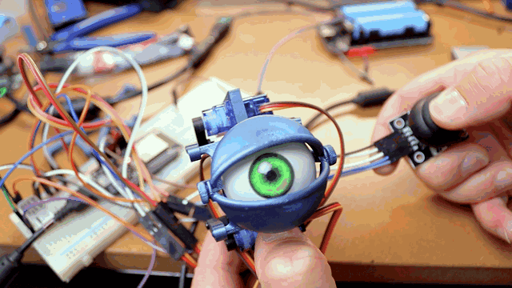

# Animatronic Eye C3

A four-servo, 3D-printed eye with a browser-based radar joystick. The ESP32-C3 SuperMini serves the interface over its own Wi-Fi access point.

- Drag to look around and adjust each eyelid independently.
- Leave it in Desk mode for small glances, random blinks, and one-minute naps, or trigger Blink, Scan, Diagonal, Roll, and Random Show manually.
- Save per-servo calibration on the board. Enable outputs explicitly after boot and use **STOP / DETACH** to end motion.

[Wiring, firmware build, and controls](AnimatronicEyeC3/README.md) · [Firmware downloads](https://github.com/LeiEugeb-ballz/AnimatronicEye-C3/releases)

## Original project

The mechanism, models, and original ESP32 firmware are by André Esser. The ESP32-C3 firmware and OCULUS web controller are this project's adaptation. [Original AnimatronicEye repository](https://github.com/Esser50K/AnimatronicEye) · [Original build video](https://youtu.be/aWKz5cGIKcs)

Print the shared eyelid linkage twice. The original designer recommends printing the spherical parts vertically to keep the spherical surfaces smoother.

## Licenses

- [Software code](LICENSE_CODE) is under the GNU General Public License.
- [3D models](LICENSE_MODELS) are under Creative Commons Attribution-NonCommercial 4.0.
